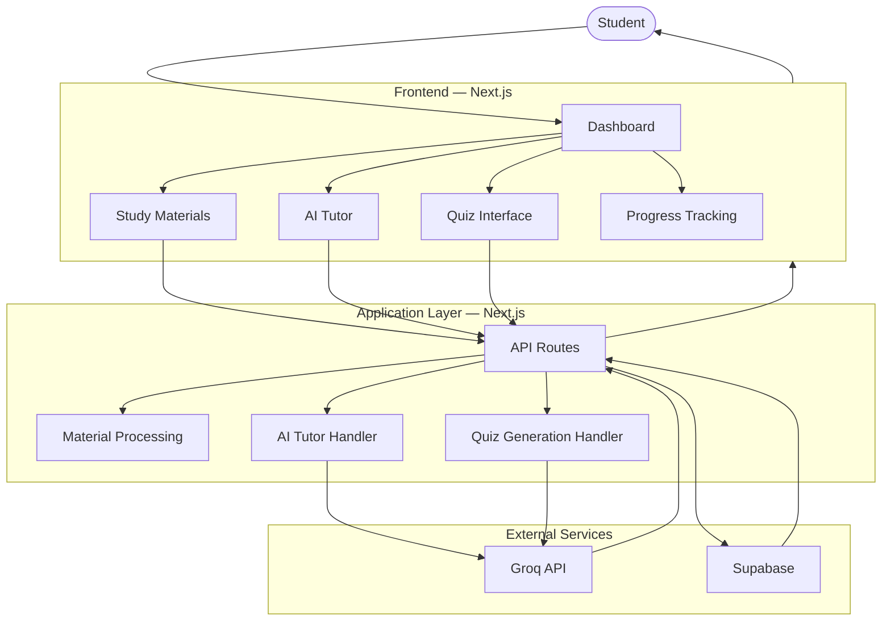
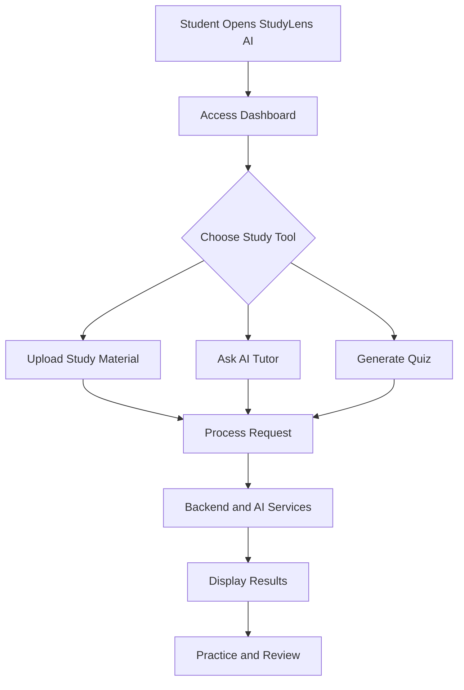

<div align="center">

# 📚 StudyLens AI

### AI-Powered Personalized Learning Companion

An interactive study platform that combines study materials, AI tutoring, and quiz generation to make learning more engaging and effective.

</div>

---

## Overview

StudyLens AI is a web-based learning companion designed to help students understand concepts, revise study materials, and practice through AI-generated quizzes.

The platform brings essential study tools together in one place, offering a more interactive approach to learning.

## Features

- **AI Tutor:** Ask questions and receive AI-generated explanations.
- **Study Materials:** Upload and access learning resources.
- **AI Quiz Generation:** Generate quizzes for practice and self-assessment.
- **Progress Tracking:** Review quiz attempts and learning activity.
- **Student Dashboard:** Access study tools through a centralized interface.

## Tech Stack

| Technology | Role |
|---|---|
| Next.js | Frontend and application framework |
| TypeScript | Application development |
| Tailwind CSS | UI styling |
| Groq API | AI-powered responses and quiz generation |
| Supabase | Authentication and backend services |

## System Architecture



## Application Workflow



## Getting Started

### Prerequisites

- Node.js
- npm
- Supabase credentials
- Groq API key

### Installation

```bash
git clone https://github.com/YOUR-USERNAME/YOUR-REPOSITORY.git
cd YOUR-REPOSITORY
npm install
```

Create a `.env.local` file and configure the required environment variables for Supabase and Groq.

Run the development server:

```bash
npm run dev
```

Open [http://localhost:3000](http://localhost:3000).

---

<div align="center">

**StudyLens AI — Learn, practice, and grow with AI.**

</div>
