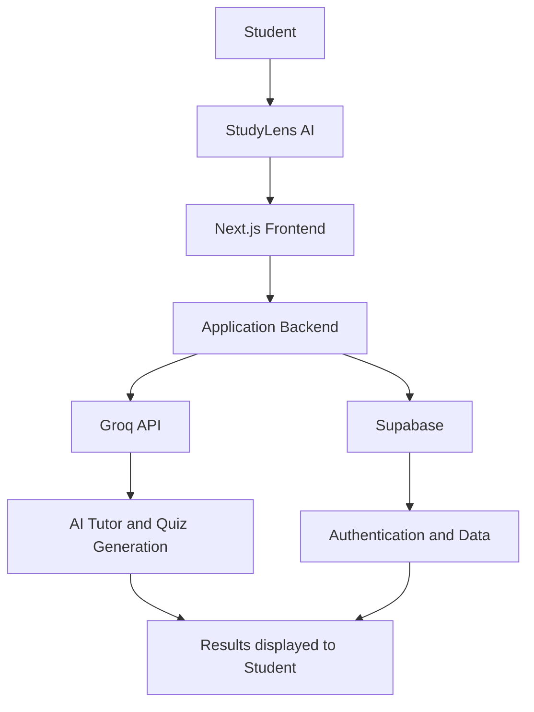

<div align="center">

# 📚 StudyLens AI

### An AI-powered study companion

Learn smarter with AI-powered tutoring, study materials, and interactive quizzes.

</div>

---

## 💡 About

StudyLens AI is an AI-powered learning platform designed to help students study more effectively.

It brings study materials, AI tutoring, and quiz generation together in one simple application, making learning more interactive and accessible.

## ✨ Features

- **AI Tutor** — Ask questions and get AI-generated explanations.
- **Study Materials** — Upload and access learning resources.
- **AI Quiz Generation** — Create quizzes for practice and self-assessment.
- **Progress Tracking** — Track quiz activity and learning progress.
- **Dashboard** — Access study tools in one place.

## 🛠️ Tech Stack

- Next.js
- TypeScript
- Tailwind CSS
- Groq API
- Supabase

## 🏗️ System Architecture



## ⚙️ Run Locally

```bash
git clone https://github.com/YOUR-USERNAME/YOUR-REPOSITORY.git
cd YOUR-REPOSITORY
npm install
npm run dev
```

Configure the required Supabase and Groq environment variables in `.env.local` before running the application.

---

<div align="center">

**StudyLens AI — Making learning more interactive with AI.**

</div>
